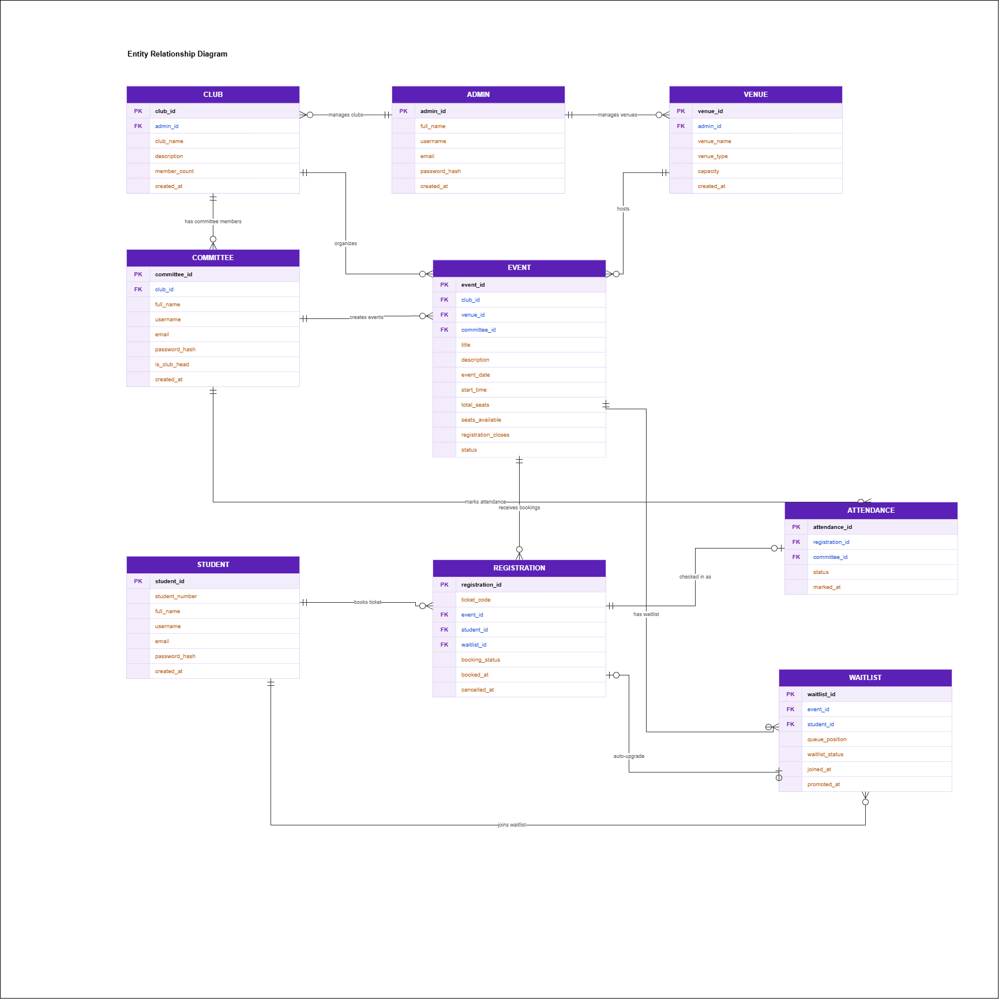

# E-Hadir: Student Event & Workshop Ticketing (U CONNECT) Storyboard

**Course:** CSC584 - Enterprise Programming  
**Group Name:** [pejalcoco]  
**Live Website:** [[https://shahruliman.github.io/uconnect/](https://shahruliman.github.io/uconnect/](https://shahruliman.github.io/CSC584_GROUP_PROJECT_STORYBOARD/))

### Group Members
| No. | Name | Student ID |
| :--- | :--- | :--- | 
| 1 | MUHAMMAD SHAHRUL IMAN BIN KAMAL | 2025382685 |
| 2 | MUHAMMAD FAIZAL BIN NOR HAZANI | 2025382145 | 
| 3 | SITI JASHNITHA BINTI ABDUL AZIZ | 2025143263 |
| 4 | SYED MUHAMMAD KAMAL NA'IM BIN SYED MOHD KHOMSAH | 2025178587 | 
| 5 | HARITH MIRZA BIN MADRADZI| 2025178523 | 

---

## Project Description
A centralized event management system for university clubs to issue digital tickets. We change e-hadir name to **U connect**.IT act as a bridges university clubs, event committees, administrators, and students on a single platform to streamline workshop discovery, seat reservations, waitlist automation, and post-event attendance tracking.

---

## Core System Features

### 1. Role-Based CRUD Operations
- **Create (Committees):** Event committees create new club events, assign venues, and configure seat capacities.
- **Read (Students & Staff):** Students browse upcoming campus events and view seat availability; committees and admins monitor event lists, clubs, and venues.
- **Update (Committees):** Committees edit event details/statuses and update student attendance statuses after each event concludes.
- **Delete (Admins):** Administrators permanently remove canceled events and manage campus clubs and venues.

### 2. Business Logic (Capacity & Waitlist Management)
A state-control algorithm that dynamically manages seat inventory:
- Deducts available tickets immediately upon student booking confirmation.
- When available capacity reaches **0**, new registrants are automatically routed to a **Waitlist** queue instead of being turned away.
- If a confirmed attendee cancels their ticket, the system automatically upgrades the next waitlisted student into a confirmed seat.

### 3. Analytics Dashboard
Provides real-time campus-wide operational insights for both Committees and Admins:
- **Top 5 Clubs by Turnout:** Ranks the highest-performing student clubs based on confirmed attendance rates.
- **Monthly Engagement Rates:** Tracks total digital tickets issued and month-over-month student participation trends.
- **Venue Utilization:** Monitors room occupancy percentages and upcoming booking schedules across campus halls and labs.

---

## Database Design (ERD)

---

## How to Run

The project is a **NetBeans 8.2 Java Web Application** (Ant). The `web/` folder holds every page, stylesheet, script and image.

> **Current status:** the pages are fully linked and runnable as a front-end prototype. Servlets, JSP and the MySQL database are added in the next stages, so the save, cancel and add buttons are previews only and the login accepts any username and password.

### Requirements

| Item | Version | Notes |
| :--- | :--- | :--- |
| JDK | 8 | NetBeans 8.2 does not work with newer JDKs |
| NetBeans IDE | 8.2 (Java EE or All bundle) | The Java SE and HTML5 bundles have no web server |
| Web server | GlassFish 4.1.1 or Apache Tomcat 8.0.x | GlassFish is included with the Java EE bundle; Tomcat 9 and 10 are not supported |

---

## Application Pages Overview

### Landing & Authentication
| Page | File Path | Description |
| :--- | :--- | :--- |
| **Welcome Portal** | `web/index.html` | Entry landing page allowing users to sign in as a **Student** or **Admin/Staff**. |
| **Student Login** | `web/html/student-login.html` | Authentication portal for students to access event bookings and digital tickets. |
| **Staff / Admin Login** | `web/html/admin-login.html` | Role-separated login screen for **Committee** and **Admin** accounts. |
| **Create Account** | `web/html/register.html` | Registration form supporting account creation for Students, Committees, and Admins. |

### Student Portal
| Page | File Path | Description |
| :--- | :--- | :--- |
| **Student Homepage** | `web/html/homepage.html` | Main student hub highlighting featured upcoming workshops, seat counters, and quick ticket access. |
| **Browse Events** | `web/html/event.html` | Filterable and searchable catalog of campus events by club with live remaining seat counts. |
| **Event Details & Booking** | `web/html/event-detail.html` | Full event schedule, venue info, and interactive booking button that triggers seat deduction or waitlist placement. |
| **My Tickets** | `web/html/myticket.html` | Digital ticket wallet displaying **Upcoming**, **Attended**, **Cancelled**, and **Waitlist** tickets with cancellation support. |
| **Digital Ticket Pass** | `web/html/myticket-detail.html` | Detailed digital event pass view with event schedule, venue, and RSVP confirmation. |

### Committee Portal
| Page | File Path | Description |
| :--- | :--- | :--- |
| **Committee Dashboard** | `web/html/committee-dashboard.html` | Analytics overview showing tickets issued, average turnout, Top 5 clubs, monthly engagement, and venue utilization. |
| **Manage Events** | `web/html/committee-event.html` | Lists all club events with search/status filters (`Open`, `Full`, `Draft`, `Cancelled`) to edit or cancel events. |
| **Create Event** | `web/html/create-event.html` | Form for committees to publish new events with organizing club, date, venue, and seat capacity. |
| **Edit Event** | `web/html/edit-event.html` | Interface to update existing event details, adjust capacities, or cancel a scheduled event. |
| **Attendance Tracking** | `web/html/committee-attendance.html` | Post-event check-in sheet where committees mark registered students as attended or absent. |
| **Campus Clubs** | `web/html/committee-clubs.html` | Directory of campus clubs displaying club heads, member counts, total events, and turnout percentages. |
| **Campus Venues** | `web/html/committee-venues.html` | Venue directory showing room capacities, utilization rates, and next scheduled bookings before planning events. |

### Admin Portal
| Page | File Path | Description |
| :--- | :--- | :--- |
| **Admin Dashboard** | `web/html/admin-dashboard.html` | Campus-wide executive dashboard tracking overall ticket volume, Top 5 clubs, monthly engagement, and venue usage. |
| **Admin Events Oversight** | `web/html/admin-event.html` | Master list of all campus events where admins enforce governance and permanently **delete canceled events**. |
| **Manage Clubs** | `web/html/admin-clubs.html` | Administrative CRUD interface to add, edit, or remove student clubs from the platform. |
| **Manage Venues** | `web/html/admin-venues.html` | Administrative CRUD interface to add, edit, or remove campus halls and labs and monitor occupancy. |
| **Attendee Audit** | `web/html/admin-attendees.html` | Read-only audit view of student booking and attendance records submitted by event committees. |
